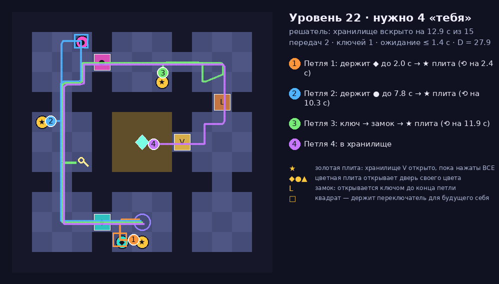

# Петля (Loop)

Кооперативные головоломки с собственными копиями для Roblox. Петля длится **15 секунд**. Потом всё откатывается к началу, а рядом появляется **призрак — ты из прошлой петли**, который точно повторяет всё, что ты делал. Хранилище открывается, только когда **все золотые плиты нажаты одновременно** и кто-то входит в дверь: на уровне с тремя плитами нужно четыре «тебя». Держи цветную плиту, пока будущий ты проходит дверь, потом беги к своей; неси ключ к замку, но не кради его у прошлого себя — иначе **парадокс**. В кооперативе (до 4 человек) призраки всех игроков общие.

Дизайн-документ: [`docs/DESIGN.md`](docs/DESIGN.md) · Плейтест в Studio: [`docs/PLAYTEST.md`](docs/PLAYTEST.md) · Публикация и монетизация: [`docs/PUBLISH.md`](docs/PUBLISH.md) · Локальная сессия Claude + Studio MCP: [`docs/LOCAL_SESSION.md`](docs/LOCAL_SESSION.md)



*Уровень 22 кампании, сгенерирован тем же кодом, что и в игре; пути — решение бота-решателя, цвет = номер петли.* Петля 1 держит ◆ первые 2 секунды (все будущие «я» успевают проскочить дверь) и встаёт на золотую плиту; петля 2 держит ● до 7,8 с; петля 3 несёт ключ к замку L и встаёт на плиту; петля 4 входит в хранилище V, когда нажаты все три ★. За 3 петли этот уровень не решить — это доказывает полный перебор.

Всё построено кодом из примитивов: уровни (комнаты, стены, двери-барьеры, плиты, хранилище), призраки, ключи, интерфейс. Сторонних моделей нет.

---

## Как запустить в Roblox Studio (Windows)

### Один раз
Rokit и плагин Rojo уже стоят после прошлых игр. Если нет — см. README репозитория `roblox`.
```powershell
cd "D:\programming\projects\2.IntelliJ_IDEA\Java"
git clone https://github.com/covest2051/roblox-loop.git
cd roblox-loop
git checkout claude/roblox-loop-game-a77s5b
rokit install
```

### Поиграть
```powershell
git pull
rojo build -o game.rbxl
```
Открой `game.rbxl` в Studio (File → Open from File), включи **View → Output**, нажми **Play** (F5).

### Живая синхронизация кода
Открой `game.rbxl`, запусти `rojo serve` (окно не закрывать), в Studio: **Plugins → Rojo → Connect**.

### Кооператив в Studio
Вкладка **Test → Clients and Servers** → 2 игрока → **Start**. Во втором окне: «Вместе» → «Войти» в уровень первого игрока.

## Управление
| ПК | Телефон | Что делает |
|---|---|---|
| WASD / стрелки | стик | ходить (прыжка нет) |
| **R** | большая кнопка **⟲ ПЕРЕМОТКА** | закончить свою петлю здесь: призрак дойдёт сюда и останется стоять |
| **Z** / Backspace | **↶ Отменить петлю** | стереть последнего призрака и переиграть его петлю |
| | ↺ Заново | стереть всех призраков уровня |
| **H** | 💡 Подсказка | белый силуэт показывает, что делать в этой петле (40 монет за уровень, с «Оракулом» бесплатно) |
| | Уровни · Магазин · Вместе · Позвать друзей | 30 уровней в 5 главах, облик призраков, кооператив |
| | DBG (только Studio) | автопрохождение, победа, уровни ±, «петли кончились», монеты, самотест, RU/EN |

---

## Для разработки

### Структура
```
src/shared/      логика без инстансов: тестируется в Lune
  Config         все числа баланса и ID товаров
  Level          генератор уровня из seed: комнаты, дерево ворот, плиты, ключи, хранилище
  Loop           модель петли: шаг 0,1 с, записи, двери, ключи, ПАРАДОКСЫ, предсказание
  Planner        «голова» бота: полный перебор (нельзя за k−1), роли + прогон (можно за k),
                 бот и базовые политики — тесты, боты-персонажи на заглушке, подсказка в игре
  Campaign       30 уровней (спецификация + подобранный seed)
  Catalog, Profile, Rewards, Strings
src/server/      LoopService (экземпляры уровней, петли, запись живых, отмена, «петли кончились»,
                 кооператив, подсказки), LevelBuilder (уровень из примитивов), данные, покупки,
                 косметика, запросы (Actions), SelfTest
src/client/      Ghosts (призраки, тени будущего, предсказание дверей, ключи, парадоксы, перемотка),
                 Hud (шкала петли, кнопки, окна), Shop, Controls, Fx, DebugPanel
tests/           *.spec.luau — правила, детерминизм, решатель и баланс; lib/Bots — та же голова
tests/engine/    прогон собранного place на «заглушке» движка (сервер и клиент)
scripts/         подбор seed'ов кампании, проверка place и API, картинка уровня, check.sh
```

### Проверки
```bash
./scripts/check.sh            # всё сразу: формат, линтер, тесты, сборка, прогоны на заглушке
```
С проверкой API (дамп берётся с GitHub):
```bash
curl -sSfLo API-Dump.json https://raw.githubusercontent.com/MaximumADHD/Roblox-Client-Tracker/roblox/API-Dump.json
API_DUMP=API-Dump.json ./scripts/check.sh
```
Что проверяется:
- `tests/loop.spec` — **правила и парадоксы**: плита открывает дверь, тело в проёме держит её, закрытие через 0,3 с; хранилище — только все плиты; ключ и замок; призрак повторяет запись бит в бит (два прогона — одинаковые журналы, события те же, что вживую); «украли ключ» → призрак рассыпается и больше ничего не нажимает; «у прошлого приоритет» в один шаг; запись в закрытую дверь → парадокс, ключ падает на пол; рассыпавшийся не держит дверь (цепочка); живого не пускает сквозь стену; предсказание = настоящий прогон;
- `tests/solver.spec` — **баланс на ботах**: каждый из 30 уровней **нельзя за k−1** (полный перебор ослабленной модели) и **можно ровно за k** (решатель, проигрыш по петлям, как в игре); финиш ≤ 13,5 с из 15; **скука**: самое долгое ожидание в решениях 5,6 с, в среднем ≤ 3,2 с за петлю; **плавность**: внутри главы шаг сложности от −2,5 до +5, каждая глава труднее; **мастерство**: решатель 30/30, новичок без «передач» 4/30 (глава 1 — 3/6, главы 4–5 — 0), новичок с лишней петлёй 9/30, «наугад» 0/90, «ничего не делать» 0/30; решение выдерживает реакцию человека 0,3 с на полной скорости — 30/30;
- `tests/level.spec` — уровни связны, двери в стенах, переключатель и ключ всегда «до» своих ворот, хранилище — лист дерева, по стартовой клетке на каждого из 4 игроков;
- `tests/catalog.spec`, `profile.spec`, `strings.spec` — шансы ровно 100%, звёзды и открытие уровней, покупки, RU/EN;
- `tests/engine/server_sim` — боты **ведут персонажей игроков** по решению на настоящем сервере: уровень из примитивов, петля за петлёй, ⟲, призрак открывает хранилище, **детерминизм при дрожании кадров** (призрак = живой шаг в шаг), ★★★ и монеты, следующий уровень, **парадокс** (украли ключ), отмена, «петли кончились» + «Лишняя петля» (окно ждёт оплату один раз), авто-отмена, подсказка, **кооператив** (вход со следующей петли, общие призраки, бюджет ⌈k/2⌉), покупки, PolicyService, чеки, сбой DataStore, автопрохождение;
- `tests/engine/client_sim` — HUD петли, R → ⟲, перемотка, призрак ровно на своей записи, тень будущего, пунктир, «in 0.7» на двери, метки на шкале, победа ★★★, осколки парадокса, Z → отмена, +1 петля, подсказка, уровни и «Вместе», магазин с шансами, регион без капсулы, **раскладка на 667×375 и при масштабе 1.25** (всё на экране, без наложений, ⟲ под палец).

### Картинка уровня
```bash
lune run scripts/export_level.luau 22 build/level.json
python3 scripts/render_level.py build/level.json docs/img/level.png
```

### Где менять баланс
`src/shared/Config.luau`: длина петли и шаг (`Loop`), запас решения для человека (`Plan.SpeedFactor`, `FinishSlack`, `ReleaseMargin`), пределы скуки (`MaxIdle`, `MeanIdle`), награды (`Rewards`). Уровни — `src/shared/Campaign.luau` (`Specs`: k, комнаты, цветные двери, замки). **После правки генератора, модели или решателя** перезапусти подбор seed'ов: `lune run scripts/gen_campaign.luau` (минута), затем `lune run tests/run.luau`.
